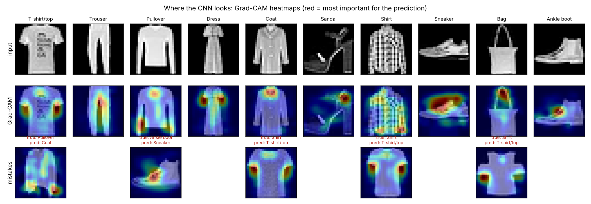
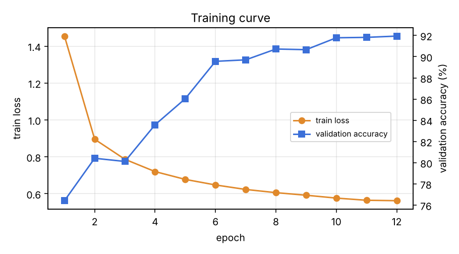
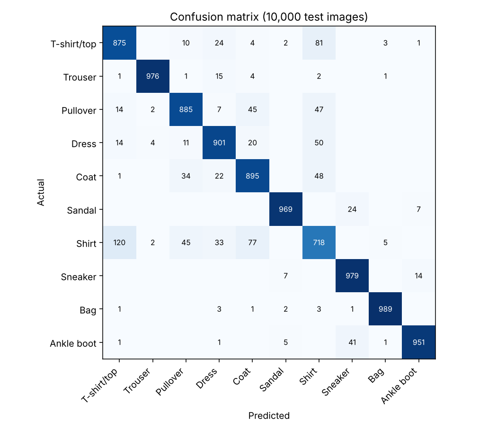

# Fashion Image Classifier with Grad-CAM


A compact convolutional neural network (66k parameters) that classifies clothing images into 10 categories, plus **Grad-CAM written from scratch** to show *which pixels* each prediction is based on, including the model's mistakes.



## Results (10,000 test images)

| Model | Test accuracy |
|---|---|
| Logistic regression on raw pixels (baseline) | 84.5% |
| **CNN (this project)** | **91.4%** |

The CNN makes **44% fewer errors** than the baseline and trains in **~16 minutes on a laptop CPU** (12 epochs, no GPU).

<p float="left">
  
  
</p>

**What Grad-CAM reveals:** the model recognises trousers by the gap between the legs, bags by the handle, and sneakers by the sole. Most mistakes are between *shirt*, *T-shirt*, *pullover* and *coat*, and the heatmaps show why: in those cases the model focuses on the sleeves and shoulders, which look almost the same in 28×28 images. *Shirt* is the hardest class (F1 0.74). All numbers are in [`reports/metrics.json`](reports/metrics.json).

## Model
```
input 1×28×28
→ [Conv3×3 → BN → ReLU] ×2, 32 channels → MaxPool        (14×14)
→ [Conv3×3 → BN → ReLU] ×2, 64 channels   ← Grad-CAM layer
→ MaxPool → Global Average Pooling → Dropout(0.3) → Linear(10)
```
Training: AdamW, one-cycle learning-rate schedule, label smoothing 0.05, random horizontal flips and ±2-pixel shifts, best checkpoint chosen on a 5,000-image validation split (never on the test set).

## Data
[Fashion-MNIST](https://github.com/zalandoresearch/fashion-mnist) by Zalando Research: 70,000 grayscale 28×28 images, 10 classes.

## Source code
The source code is kept private. I'm happy to walk through the implementation, design decisions and results in an interview: [LinkedIn](https://www.linkedin.com/in/mohamed-atef-elsayed) · [Email](mailto:mohamed300atef@gmail.com)

## Author
**Mohamed Atef Elsayed**, AI Engineer · ML Engineer · Data Scientist
[LinkedIn](https://www.linkedin.com/in/mohamed-atef-elsayed) · [Portfolio](https://mohamedatefelsayed.vercel.app)
